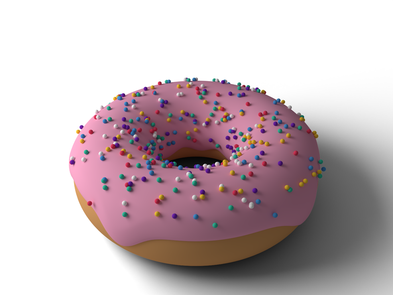
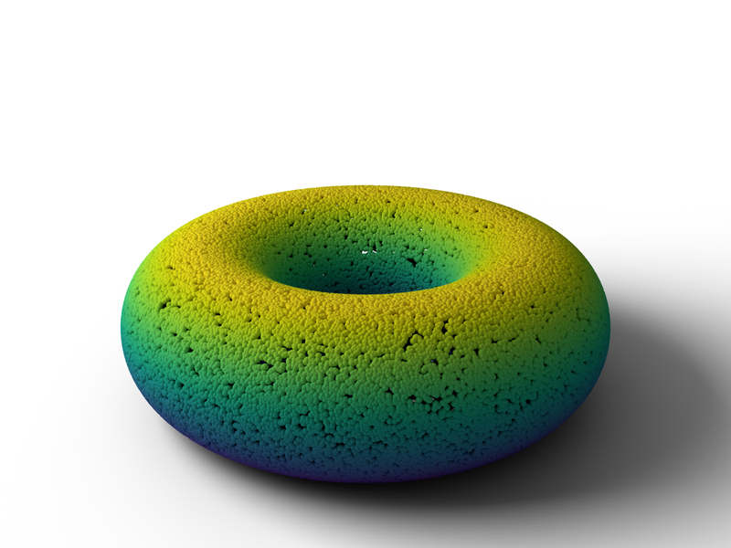
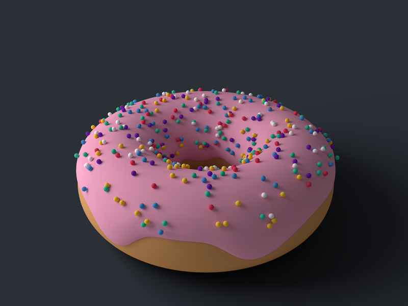
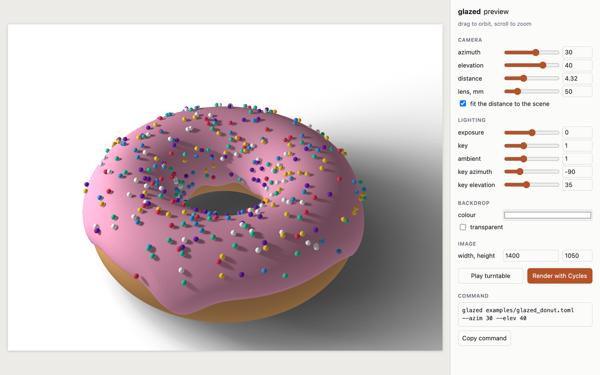
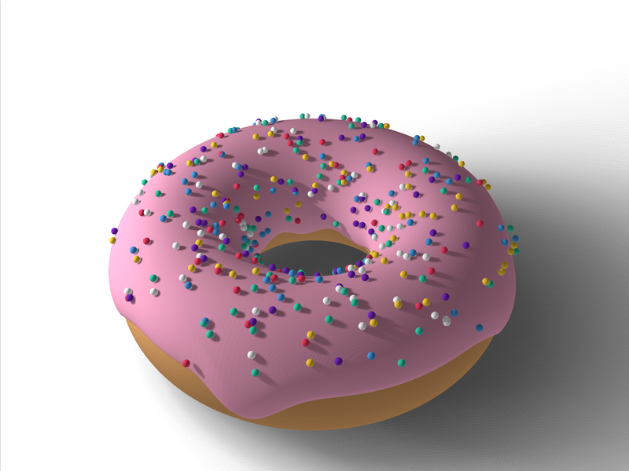
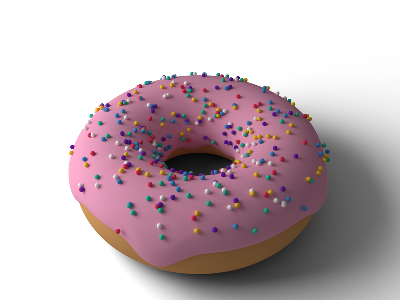

<div align="center">

# 🍩 glazed

**Studio-lit Blender Cycles renders of point clouds, meshes, and scenes mixing both.**

[](#installation)
[](#rendering)
[](#preview-in-the-browser)
[](#claude-code-plugin)

[Installation](#installation) ·
[Quickstart](#quickstart) ·
[Preview](#preview-in-the-browser) ·
[Rendering](#rendering) ·
[Scene files](#scene-files) ·
[Claude Code plugin](#claude-code-plugin)

|  |  |  |
|:---:|:---:|:---:|
| Meshes and an RGB point cloud | A point cloud through a colormap | Any backdrop |

[](#preview-in-the-browser)

<sub>Pick the view in a live browser preview, then render it with the command it hands back.</sub>

</div>

Raw 3D assets in, finished pieces out. Like a potter's glaze and firing, glazed
colours point clouds, meshes, and scenes mixing both, then fires them in Blender
Cycles: seamless backdrop, soft side light, contact shadows, and colormaps that
stay true to their colorbars. Renders stills, turntable videos, and GIFs.

## Highlights

- **Point clouds, meshes, or both** in one scene: `.npy`, `.ply`, `.stl`, `.obj`,
  `.glb`, `.gltf`, and `.fbx`, laid out by a small TOML scene file.
- **A studio look out of the box**: a seamless backdrop, a soft side light, contact
  shadows, and Blender's Standard view, so colormaps match their colorbars.
- **Stills, turntable videos, and GIFs** from one command, with camera paths for
  custom shots.
- **A live browser preview** that frames and lights the scene like the render and
  hands back the matching command.
- **Exports from any research codebase**: `glazed.io` needs only numpy and takes
  torch tensors on any device.
- **A Claude Code plugin** that teaches Claude to export and render your project's
  outputs.

## Installation

glazed has two parts, usually installed in two environments:

```bash
pip install glazed              # glazed.io and the preview: numpy only, Python >= 3.9
pip install "glazed[render]"    # the renderer: Blender's bpy, Python 3.13 only
```

| Part | Install into | Needs |
|---|---|---|
| `glazed.io` and `--preview` | your research project's environment | Python ≥ 3.9, numpy |
| The renderer | a separate environment | Python 3.13, for Blender's `bpy` 5.x |
| Videos and GIFs | | `ffmpeg` on the PATH |

To work on glazed itself, install a checkout: `pip install /path/to/glazed`,
adding `-e` while developing.

### Without installing

Blender can run glazed from a source checkout with its own Python:

```bash
blender -b -P render.py -- examples/donut.npy
```

This needs Blender 5.x, with `matplotlib` installed into Blender's bundled Python.

## Quickstart

The repository ships a glazed donut to try everything on. In the render
environment:

```bash
glazed examples/glazed_donut.toml --preview             # pick a view in the browser
glazed examples/glazed_donut.toml --elev 35 --gpu       # outs/glazed_donut.png
glazed examples/glazed_donut.toml --mode mp4 gif --gpu  # a turntable video and GIF
```

The example files are baked by `examples/make_donut.py` using only `glazed.io`,
so it doubles as a worked example of exporting scenes.

## Exporting from your project

```python
from glazed.io import save_mesh, save_points, write_scene

save_mesh("out/object.ply", vertices, faces)               # numpy arrays or torch tensors
save_points("out/pred.npy", points, values=per_point_error)
write_scene("out/scene.toml", [
    {"path": "out/object.ply", "color": "#c9ccd1"},
    {"path": "out/pred.npy"},
])
```

Point clouds are `.npy` arrays of shape (N, 3) xyz, (N, 4) xyz + value, or
(N, 6) xyz + RGB. Meshes can be `.ply`, `.stl`, `.obj`, `.glb`, `.gltf`, or `.fbx`;
`save_mesh` writes PLY, which Blender reads with coordinates as stored, while OBJ
files are treated as Y-up. `glazed.io` also has `sample_surface`, `to_z_up`,
`check_alignment`, `grid_locations`, `read_scene`, and `check_scene`.

## Preview in the browser

A Cycles render takes minutes, so pick the view and lighting in a live preview
first:

```bash
glazed examples/glazed_donut.toml --preview
```

This opens the scene in the browser, framed and lit like the render. Drag to
orbit, scroll to zoom, and adjust the lighting, backdrop, colormap, and image size
in the panel, which shows the matching `glazed` command to copy, including the
other options you passed. **Render with Cycles** renders the current view at
preview quality to check the real look, and **Play turntable** plays a video's
orbit at its real speed.

| Live preview | Cycles render of the copied command |
|:---:|:---:|
|  |  |

The same view, `glazed examples/glazed_donut.toml --azim 30 --elev 40`, in the
preview and rendered by Cycles.

The preview needs only numpy, so it runs in a research environment too. There,
the Cycles button is off, since it needs bpy, and colormaps other than viridis
need matplotlib. On a remote machine, pick a port and forward it:
`glazed scene.toml --preview --port 8765`, then `ssh -L 8765:localhost:8765 <host>`
and open `http://localhost:8765`. The page loads three.js from a CDN, so the
browser needs internet access. Soft floor shadows are approximate, mostly where
several objects' shadows overlap; the Cycles button shows the real ones.

## Rendering

```bash
glazed examples/glazed_donut.toml --elev 35 --gpu        # dough and glaze meshes, RGB sprinkles
glazed examples/donut.npy --gpu                          # a point cloud, coloured by height
glazed examples/glazed_donut.toml --mode mp4 gif --gpu   # a turntable video and GIF
glazed mesh.ply cloud.npy --bg "#2b2f36" --gpu           # any files, dark backdrop
glazed --help                                            # every option
```

### Outputs

Output goes to `outs/<first input's name>` plus an extension per mode. Set the
path with `--out figs/teaser`; `--out figs/teaser.png` works too, without doubling
the extension.

| Output | Path |
|---|---|
| Still (`--mode still`, the default) | `outs/glazed_donut.png` |
| Video and GIF (`--mode mp4 gif`) | `outs/glazed_donut.mp4`, `.gif`, with frames kept in `outs/glazed_donut_frames/` |
| Frames only (`--mode png`) | `outs/glazed_donut_frames/frame_00000.png`, ... |
| Several colormaps (`--cmap viridis magma`) | `outs/donut_viridis.png`, `outs/donut_magma.png` |
| `--colorbar`, `--save-blend` | `outs/donut_colorbar.png`, `outs/donut.blend`, suffixed per colormap like the renders |

`--no-keep-frames` deletes the frames once the video is encoded.

### Lighting and camera

The studio is one soft key light from the side, white ambient fill, and a floor
that only catches shadows. The lights turn with the camera, like a turntable under
fixed lights, so an orbit looks the same from every angle.

| Option | Default | |
|---|---|---|
| `--exposure` | `0` | stops; `-1` halves the brightness |
| `--key` | `1` | key light strength |
| `--ambient` | `1` | fill light; lower gives darker shadows and more contrast |
| `--key-azim` | `-90` | key angle from the camera, degrees, negative to its left; near 0 looks flat, near ±90 shows the most depth |
| `--key-elev` | `35` | key height, degrees; lower gives stronger shading on curved surfaces |
| `--bg` | `white` | backdrop, any matplotlib colour; `--transparent` leaves it transparent for compositing |
| `--azim`, `--elev` | `45`, `22` | camera angle, degrees; an orbit starts here |
| `--distance` | fits the scene | multiple of the scene's half-size |
| `--lens` | `50` | mm; shorter gives stronger perspective |
| `--cmap`, `--vmin`, `--vmax` | `viridis`, data range | colours per-point values; the range is shared across the scene |

### Turntables and camera paths

Video modes orbit the scene, by default `--frames 120 --fps 30 --turns 1`, which
loops seamlessly. `--elev-amp 10` adds an up-and-down sway, `--dolly 0.15` pushes
in by 15% over the shot, and `--ease` slows the start and end, which breaks the
loop. `--gif-width` sets the GIF's width (720).

`--waypoints path.json` replaces the orbit with a smooth spline through camera
positions. Coordinates are in normalised scene units: the scene is centred on the
origin with a largest half-side of 1. `target` is optional and defaults to the
orbit's centre.

```json
{"eye": [[3, -3, 1], [3, 3, 1.5], [-3, 3, 1]], "target": [[0, 0, 0]], "loop": true}
```

### Quality

Renders default to `--res 1400 1050 --samples 256 --supersample 2`, rendering at
twice the resolution and filtering down for clean edges. `--gpu` uses the first of
OptiX, CUDA, HIP, Metal, or oneAPI it finds, and falls back to the CPU. Preview
views with `--res 480 360 --samples 32 --supersample 1`; for videos,
`--res 1280 720 --samples 128 --supersample 1` keeps frame times down.
`--save-blend` also saves the scene as a `.blend` to adjust by hand in Blender.

### Python API

In the render environment:

```python
from glazed.io import AssetSpec
from glazed.render import render
from glazed.settings import RenderSettings, View

render([AssetSpec("examples/donut.ply", color="#d9a066"),
        AssetSpec("examples/glaze.ply", color="#f4a6c6"),
        AssetSpec("examples/sprinkles.npy", radius=0.0009)],
       out="outs/glazed_donut", settings=RenderSettings(gpu=True), view=View(elev=35))
```

`out` works like `--out` and defaults to `outs/render`. `modes` takes the
`--mode` values, e.g. `modes=("mp4", "gif")`, and the other options live in
`glazed.settings` as dataclasses: `RenderSettings`, `Lighting`, `View`,
`Animation`, and `Colormap`.

## Scene files

```toml
[[objects]]
path = "cloud.npy"
radius_scale = 1.25

[[objects]]
path = "mesh.ply"
color = "#c9ccd1"
location = [7.5, 0, 0]   # in the file's own units
rotation = [0, 0, 90]    # degrees about x, y, z
```

| Key | Default | |
|---|---|---|
| `path` | required | relative to the scene file |
| `color` | `"#cccccc"` | any matplotlib colour; `"original"` keeps a mesh's own materials. Ignored for (N, 4) and (N, 6) point clouds |
| `location` | `[0, 0, 0]` | file units |
| `rotation` | `[0, 0, 0]` | degrees about x, y, z, pivoting on the file's origin |
| `scale` | `1.0` | uniform |
| `radius` | automatic | point clouds, file units |
| `radius_scale` | `1.0` | point clouds, multiplier on the automatic radius |
| `smooth` | `true` | meshes, smooth shading |

The world is Z-up. `--color`, `--radius` and `--radius-scale` set defaults that
entries override. The same structure in JSON (`{"objects": [{...}, ...]}`) also
works.

## Claude Code plugin

This repository is also a Claude Code plugin. Its `glazed-render` skill teaches
Claude, working in your research project, to export the project's outputs with
`glazed.io`, keep the parts of a scene aligned, and render them. Domain guides in
`skills/glazed-render/references/` cover specific kinds of projects, starting with
hand-object grasps. Install it once, for every project:

```
/plugin marketplace add /path/to/glazed      # or <owner>/<repo> once it's on GitHub
/plugin install glazed@glazed
```

## Extending

- **New file type:** list its suffix in `glazed/io.py`, then map it to a Blender
  importer in `IMPORTERS`, or to an `Asset` subclass in `LOADERS`, in
  `glazed/render/assets.py`. For the preview, map it to a three.js loader in
  `LOADERS` in `glazed/preview.html`.
- **New asset type:** subclass `Asset`, build its objects in `__init__`, and
  override `paint()`.
- **New domain guide for the skill:** add a Markdown file to
  `skills/glazed-render/references/` and list it in `SKILL.md`.

## Acknowledgements

glazed renders with [Blender](https://www.blender.org/)'s Cycles through its
`bpy` module, and its preview runs on [three.js](https://threejs.org/), whose
percentage-closer soft shadows example the preview's floor shadows adapt.
