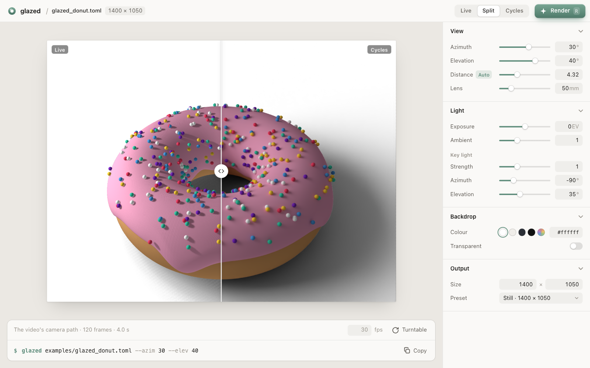
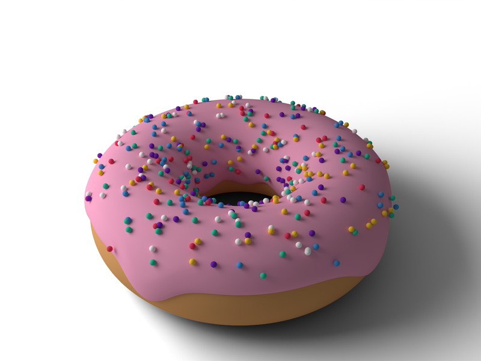
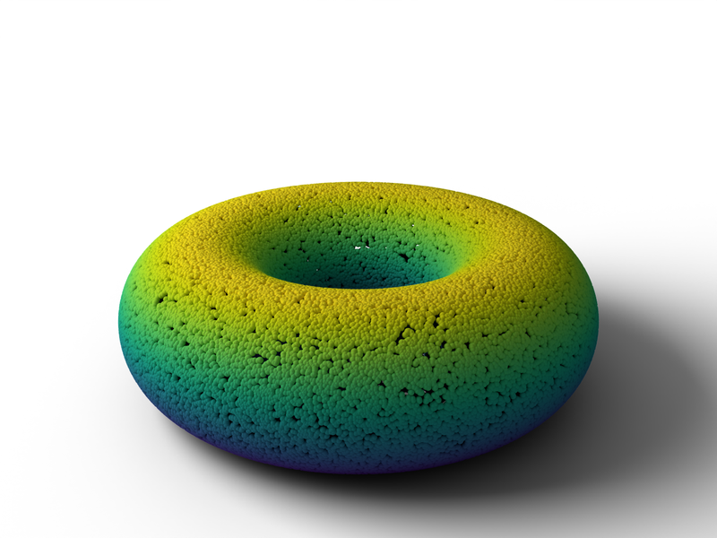
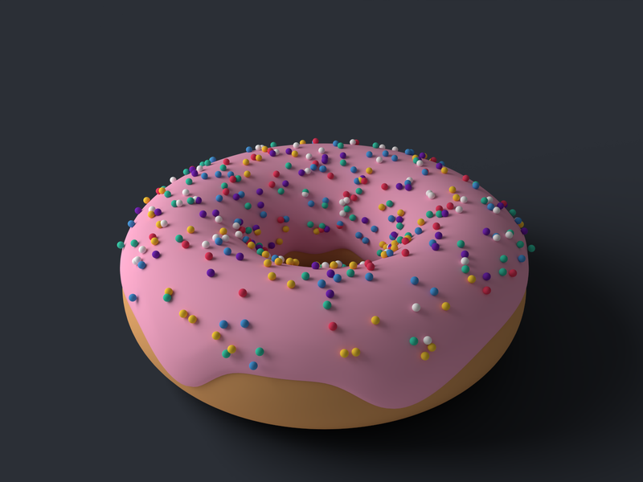

<div align="center">

# 🍩 glazed

**Studio-lit Blender Cycles renders of point clouds, meshes, and scenes mixing both,
set up in a live browser preview.**

[](#installation)
[](docs/command-line.md)
[](#the-preview)
[](#claude-code-plugin)

[Installation](#installation) ·
[Quickstart](#quickstart) ·
[The preview](#the-preview) ·
[Your own data](#your-own-data) ·
[Command line](docs/command-line.md) ·
[Claude Code plugin](#claude-code-plugin)

[](#the-preview)

<sub>Set up the shot in the preview, check it against Cycles, then paste the command it hands back.</sub>

|  |  |  |
|:---:|:---:|:---:|
| Meshes and an RGB point cloud | A point cloud through a colormap | Any backdrop |

</div>

Raw 3D assets in, finished pieces out. Like a potter's glaze and firing, glazed
colours point clouds, meshes, and scenes mixing both, then fires them in Blender
Cycles: seamless backdrop, soft side light, contact shadows, and colormaps that
stay true to their colorbars.

Everything starts in the preview: open your files in the browser, set up the shot
by eye, check it with a real Cycles render, and copy the command that renders it
for good.

- **A live preview for every shot**, with a Cycles render one key away.
- **A command to paste**: the preview hands back the `glazed` command for its shot.
- **Point clouds, meshes, or both**: `.npy`, `.ply`, `.stl`, `.obj`, `.glb`, `.gltf`,
  `.fbx`, and USD, including animated simulation replays.
- **Stills, turntable videos, and GIFs** in a studio look, out of the box.
- **Exports from any research codebase** with `glazed.io`, which needs only numpy,
  and **a Claude Code plugin** that does it for you.

## Installation

```bash
pip install "glazed[render]"   # the full preview and the renderer: Blender's bpy, Python 3.13 only
pip install glazed             # glazed.io and a preview without Cycles: numpy only, Python >= 3.9
```

Install the render extra in its own Python 3.13 environment, and the plain package
into your research project's environment to export scenes. Videos and GIFs need
`ffmpeg` on the PATH. To work on glazed itself, `pip install -e /path/to/glazed`.

## Quickstart

The repository ships two examples to try everything on: a glazed donut, and
`examples/grasp.usd`, an animated replay of a robot hand grasping an apple. In
the render environment:

```bash
glazed examples/glazed_donut.toml --preview --gpu
```

1. Drag to orbit, and set up the shot in the panel.
2. Press **R** to render it with Cycles, and **Split** to compare.
3. **Copy** the command under the image and run it:

```bash
glazed examples/glazed_donut.toml --azim 30 --elev 40 --gpu   # outs/glazed_donut.png
```

Add `--mode mp4 gif` for a turntable video and GIF of the same shot. For the
replay, open it and press Space to play it:

```bash
glazed examples/grasp.usd --preview --gpu --every 2 --color original
```

## The preview

`glazed <files> --preview` opens the scene in the browser, framed and lit like the
render, at its size. Drag to orbit and scroll to zoom.

- **Set up the shot.** The panel holds the view, light, backdrop, colormap, and
  image size, each an option of the command. Drag a setting's name to change it,
  double-click it to reset it, or type a value.
- **Check it with Cycles.** **Render** (R) renders the view with Cycles in a few
  seconds, at the size it's shown and with 16 samples, and of an animation's first
  frame, as a still is. **Split** compares it with the live view across a divider,
  and marks it once a setting changes. Start the preview with `--gpu` to render on
  the GPU.
- **Play animations and turntables.** Play (Space), pause, and scrub an animated
  file such as a USD simulation replay, or play the video's camera path with
  **Turntable**, at the video's fps.
- **Copy the command.** The bar under the image holds the `glazed` command for the
  shot. Options the panel doesn't set, such as `--mode`, `--samples`, or `--every`,
  come from the command that started the preview, so start it with them:

  ```bash
  glazed examples/grasp.usd --preview --gpu --mode mp4 --every 2 --turns 0 --color original
  ```

Keys: Space plays or pauses, R renders, F fits the distance to the scene, and Esc
returns to the live view.

Without bpy, the preview still runs, on numpy alone, but can't render or open USD
files; colormaps other than viridis need matplotlib. The page loads three.js from a
CDN, so the browser needs internet access. On a remote machine, start it with
`--port 8765`, forward the port with `ssh -L 8765:localhost:8765 <host>`, and open
`http://localhost:8765`. The [command-line reference](docs/command-line.md) lists
every option, and which ones the panel sets.

## Your own data

Export your project's outputs with `glazed.io`, in the project's own environment:

```python
from glazed.io import save_mesh, save_points, write_scene

save_mesh("out/object.ply", vertices, faces)               # numpy arrays or torch tensors
save_points("out/pred.npy", points, values=per_point_error)
write_scene("out/scene.toml", [
    {"path": "out/object.ply", "color": "#c9ccd1"},
    {"path": "out/pred.npy"},
])
```

Then open it: `glazed out/scene.toml --preview`. [Scene files](docs/scene-files.md)
covers the formats, the other helpers, and every key of a scene file;
`examples/make_donut.py` bakes the donut this way.

## Claude Code plugin

This repository is also a Claude Code plugin. Its `glazed-render` skill teaches
Claude, working in your research project, to export the project's outputs with
`glazed.io`, keep the parts of a scene aligned, and render them. Domain guides in
`skills/glazed-render/references/` cover specific kinds of projects, starting with
hand-object grasps. Install it once, for every project:

```
/plugin marketplace add /path/to/glazed      # or <owner>/<repo> once it's on GitHub
/plugin install glazed@glazed
```

## More

- [Command line](docs/command-line.md): outputs, every option, turntables and camera
  paths, animated files, best view, quality, and the Python API.
- [Scene files](docs/scene-files.md): input formats, `glazed.io`, and scene-file keys.
- [Extending](docs/extending.md): new file types, asset types, and skill guides.

glazed renders with [Blender](https://www.blender.org/)'s Cycles through its
`bpy` module, and its preview runs on [three.js](https://threejs.org/), whose
percentage-closer soft shadows example the preview's floor shadows adapt.
